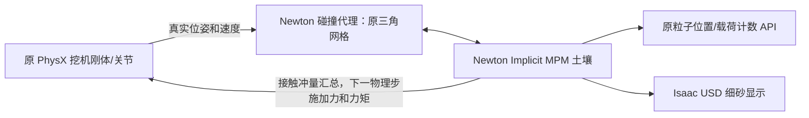

# Newton MPM 土壤接入说明（2026-10-25）

当前默认配置已更新为**材料点不超过 40000、约 7.5 cm 采样间距和 10 cm 求解网格、固定 120 Hz MPM 子步、GPU 汇总接触力**。性能优化及新回归记录见 [NEWTON_MPM_OPTIMIZATION.md](NEWTON_MPM_OPTIMIZATION.md)。下方历史密采样回归记录保留用于对照。

## 修改边界

目标是把已验证的干燥颗粒土壤接入原挖机场景，保留原控制器、运动规划、相机、桥接协议、采集和评估入口。



挖机仍由 PhysX 积分。土壤和土壤接触由 Newton 计算，通过分区耦合回传反作用力。代理读取真实质量、质心和惯量；采用 Newton 官方双向示例的延迟耦合时序，扣除上一轮接触冲量后求解替代冲量。**这不是把整台挖机改成 Newton 刚体求解器**，也不是仅把外部动画导入 Isaac。小场景已验证反作用力会影响真实 PhysX 刚体。

## 文件

服务器两个子仓库各自加载土壤，因此都接入相同适配器：

- `ExcavatorVLA-isaac/scripts/excavator_app/newton_mpm_soil.py`：材料采样、三角碰撞网格导入、MPM 步进、双向受力、显示与兼容 API。
- `ExcavatorVLA-isaac/scripts/excavator_app/sand_site_runtime.py`：新增有界的后端分支和清理钩子；保留原 PhysX 分支。
- `ExcavatorVLA-smolvla/scripts/excavator_app/`：同样两份文件。
- `ExcavatorVLA-smolvla/run_simulation.py`：修改土壤沉降和持续评估中的土壤重置分支；MPM 沉降循环只调用一次物理步，避免 `world.step()` 后再 `app.update()` 导致额外步进。模型动作和相机时序保持原逻辑。

外层 `collect.sh`、`eval_smolvla_success.sh`、`run_isaac_python.sh`，以及原挖机控制代码和 USD 资产保持原文件内容。旧矩形挡墙只作为隐藏、无碰撞的生成参考；土堆不靠它支撑。显式请求的圆形墙仍可作为碰撞体导入。

## 物理和计数

- 当前默认网格下限 **0.10 m**；源体积更大、采样点超过 40000 时，采样间距和网格同步增大，完整保留源覆盖范围。
- 干燥摩擦颗粒材料：摩擦系数 0.68，黏度、抗拉强度和黏聚屈服应力为 0。默认保持原场景的总土壤质量（原粒子数 × 原 `PARTICLE_MASS`），再分配到细化后的 MPM 材料点，避免细化采样时无意增加整机载荷。本次原场景约 2.64 万个计数点、每点 0.36 kg，总质量约 9.5 t；对应当前源体积的等效密度约 600 kg/m³。此为控制/计数兼容设置，不是已经标定的真实干沙密度。显式指定 `EXCAVATOR_MPM_DENSITY` 可覆盖；不提供原质量的独立测试默认 1600 kg/m³。
- 沿用测试的近乎完全塑性设定：Young 模量 1e15 Pa，压缩屈服压力 1e12 Pa。这是视觉/交互基线，尚未做真实土样标定。
- MPM 最大子步 1/120 s；跟随原 PhysX 实际 `dt`，暂停时不靠渲染帧偷跑。
- 对 60 Hz 的 float32 `dt` 消除舍入误差，每个物理步固定两个 MPM 子步，避免 `ceil` 意外变成三个。按用户要求不再由最高颗粒速度增加全局子步。每子步调用 Newton 的真实碰撞网格投影修正穿入，查询带至少 25 cm；20 m/s 单点测试通过仍不构成任意高速条件下的保证。
- 地面、停车地板和卡车的静态三角网格分别作为碰撞体。运动铲斗接触边距上限保持 1.25 cm，避免随粗网格扩大额外支撑。若材料越过地面超过三格，暂停并报错。
- 仅当**所有**材料点的最大速度连续三次检查（间隔 15 个物理步）低于 1 cm/s，且所有运动刚体的保守扫掠包围盒均远离土壤，才让静止土壤休眠。刚体靠近即唤醒；带料铲斗也会保持土壤运行。不是按固定时长冻结土堆。可设置休眠阈值为 0 禁用此优化。
- 原场景土方量约 16 m³，明显大于独立测试的 0.175 m³。当前采样间距默认至少 7.5 cm，完整源按相同比例粗化至最多 40000 个材料点；不截掉一侧土壤来压低数量。旧密采样版约 342 万材料点、显存约 15–18 GB，其性能记录只作历史对照。
- 采集/评分继续读取原数量级的代表材料点：从真实 MPM 材料点 ID 中确定性均匀抽样，ID 在一轮内不变，代表点总质量等于完整材料总质量。这样细化 MPM 不会仅靠增大点数降低原来以粒子数表达的阈值。该采样仍有统计误差，不能声称与旧 PhysX 的成功率严格等价。
- 细砂是被动显示样本，不参与物理和评分，当前总量最多 16 万。显示点直径随采样间距适当增大；逐物理步更新保留，以免改变采集图像和状态的对齐。
- 细砂显示使用原生 `UsdGeom.Points`。网格接触冲量在 GPU 原子汇总，每个子步只回读每刚体的 6 个受力分量；最大粒子速度也在 GPU 归约，仅回读 1 个标量，不再每步下载全部速度。
- 铲斗用原始三角网格保留凹面和开口，不使用封闭斗口的凸包。
- USD 实例代理中的碰撞几何也会遍历；原场景实际启用哪些碰撞体，就导入哪些碰撞体。

## 启动

服务器基础目录：`/root/gpufree-data/ExcavatorVLA_new`。

```bash
cd /root/gpufree-data/ExcavatorVLA_new
export POLICY_PYTHON=/root/gpufree-data/conda/envs/ExcavatorVLA-current/bin/python
export OMNI_KIT_ALLOW_ROOT=1
bash collect.sh 1 1 0
bash eval_smolvla_success.sh /absolute/path/to/checkpoint/pretrained_model 1 350 100
```

默认后端为 `newton_mpm`。无需安装、升级或切换服务器环境；使用现有 Isaac 6.1 RC、Newton 1.5.0、Warp 1.16.0。仅启用 bundled Newton Python 包，不启用 Isaac 的实验性原生 Newton 后端。无网络时，已有 Hugging Face 模型缓存可用 `HF_HUB_OFFLINE=1 TRANSFORMERS_OFFLINE=1`；这些只是进程环境变量。

可选参数：

| 环境变量 | 默认 | 用途 |
| --- | --- | --- |
| `EXCAVATOR_SOIL_BACKEND` | `newton_mpm` | `physx` 可切回保留的旧分支 |
| `EXCAVATOR_MPM_VOXEL_SIZE` | `0.10` | 请求的最小网格边长 m；预算不足时和间距同步增大 |
| `EXCAVATOR_MPM_PARTICLE_SPACING` | 网格的 `0.75` 倍 | 请求的最小采样间距；不能大于网格 |
| `EXCAVATOR_MPM_MAX_PARTICLES` | `40000` | 硬上限，可调低，拒绝大于 40000 |
| `EXCAVATOR_MPM_RENDER_DIAMETER` | `0.012` | 仅显示细砂的直径 m，不参与材料体积、质量或碰撞 |
| `EXCAVATOR_MPM_DENSITY` | 保持原总质量 | 显式设置密度 kg/m³ 时覆盖原总质量兼容逻辑 |
| `EXCAVATOR_MPM_DEVICE` | 原 PhysX CUDA device | 排查时显式指定 CUDA 可见设备序号 |
| `EXCAVATOR_MPM_SEED` | `4107` | 初始材料采样抖动种子 |
| `EXCAVATOR_MPM_SLEEP_SPEED` | `0.01` | 静止速度阈值 m/s；0 禁用休眠 |

## 历史密采样版验证（优化前）

1. `experiments/isaac_mpm_soil/test_soil_adapter.py`：6 项 CPU 测试，覆盖刚体侧冲量/力矩符号、静态碰撞不回传、三角面绕向、采样质量守恒/预算和可复现性、float32 步长和高速 CFL，以及细化采样保持原总质量。
2. `experiments/isaac_mpm_soil/verify_physx_mpm.py`：真实 Isaac 测试，覆盖落土、地面、有限质量反作用力、偏心质心、暂停、重置不叠加回调、休眠/唤醒和真实相机可见性。还覆盖 20 m/s 颗粒对平面/停车地板的防穿透，以及完整状态缓存后搬移、恢复和重新碰撞。当前默认密采样下 240 个物理步通过，3 kg 刚体最低中心高度约 0.209 m，最高约 0.422 m，终态速度约 0.077 m/s，峰值向上反作用力约 178 N。相机可见性断言通过。此为有界接口/稳定性回归，不是材料标定或整机挖掘载荷认证。
3. 原 `collect.sh` 的保留 PhysX 分支对照：在隔离目录已成功采集并导出 1 条数据。
4. 原 `eval_smolvla_success.sh` 的当前密采样/原总质量版本回归：两轮均 `status=completed`、`error=null`，每轮执行 8 个策略动作；首轮为新进程，第二轮复用进程。首轮启动约 375 s，第二轮完整重置准备约 22.6 s，其中 MPM 状态恢复约 4.0 s。两轮短回归均为 `success=false/no_scoop`，仅验证接口和流程，不能当作完整 350 步策略成功率。结果目录为备份下 `validation_eval_032024`。
5. 原 `collect.sh` 的新土壤完整采集/导出回归：**已完成**。命令 `bash collect.sh 1 1 0`，测试数据写入隔离的 `DATA_ROOT`。3 次尝试中 1 条通过原质量门槛、2 条被拒收，无执行失败；最终 `target_successes_reached`，父脚本输出 `Exported 1/1 successful episodes`。导出 1 个 episode、178 帧、10 Hz，保留 28 维状态、4 维 effort、4 维动作和 3 路 256×256 相机视频。没有降低收斗、载荷或训练数据质量门槛。成功条目原评分为 48.9，收斗 572 个计数点、抬升 552 个、进入车厢 106 个、洒落 446 个；说明流程能完成，载土保持与卸料效率仍需改进，不能把“可导出”当作已达到高质量挖掘效果。该条仿真时长 17.75 s、实际执行约 2455 s（41 分钟），当前密采样明显慢于实时。

小场景通过不等于旧策略在新材料上仍达到旧成功率。完整场景比独立测试大，首次 Warp JIT 编译和每步计算开销需要单独观察。延迟耦合有一物理步的反作用力延迟；自由刚体惯量近似不能完全代替受约束关节系统的有效惯量。真实铲斗的载荷、漏料和策略成功率仍应单独标定。

最终核验记录为备份目录下 `integration_verification.json`，同时保存到本地 `tmp/newton_integration/`。测试数据、测试日志全部位于备份目录内的 `validation_collect` 和 `validation_eval_032024`，不追加到原训练数据集。回归进程已结束。

导出产物另经只读核验：Parquet 共 178 行，状态/effort/动作分别为 28/4/4 维且全部有限；三路 MP4 均可完整解码为 178 帧、17.8 s。明细为 `export_verification.json`。

### 进程复用的重置

标准评估默认 `--fresh-simulator`，每轮仍完整创建并沉降土壤。显式选择诊断选项 `--no-fresh-simulator` 时，同规格土壤恢复完整的已沉降初始状态，包括位置、速度、应力、塑性体积、形变和显示细砂；按新沙堆中心平移，并重建小型碰撞模型以更新卡车位置。网格编号等数值缓存不从旧状态复制，使用 `solver.reset(flags=0)` 清除 warm start，同时保留恢复的物理应力和形变。随后短暂运行 15 个物理步。

这避免在原客户端 120 秒重置超时内重新生成和沉降百万材料点。土量、源形状等规格改变时，回退到完整重建。诊断复用恢复的是首轮实际沉降形态，其微观采样不保证与另一进程按新场景种子重新生成完全相同；标准新进程评估不受此近似影响。

## 备份和回退

服务器备份：

`ExcavatorVLA-isaac/backups/soil_mpm_20261025_172114/`

其中 `code_before.tar.gz` 保存修改前 177 个源码/入口文件，`manifest.json` 记录逐文件 SHA256。`deployed_manifest.json` 记录本次部署版本。部署前逐一核对原文件，部署后检查其余备份源码没有变化。

停止采集/评估后，临时用旧后端：

```bash
EXCAVATOR_SOIL_BACKEND=physx bash collect.sh 1 1 0
```

恢复原文件（检测后续未知修改，有未知修改则拒绝覆盖）：

```bash
python ExcavatorVLA-isaac/experiments/isaac_mpm_soil/restore_soil_integration.py \
  --backup /root/gpufree-data/ExcavatorVLA_new/ExcavatorVLA-isaac/backups/soil_mpm_20261025_172114
```

只恢复三份原源码、移除两份新增适配器，不解压覆盖父目录、资产或环境。测试及测试输出保留。
