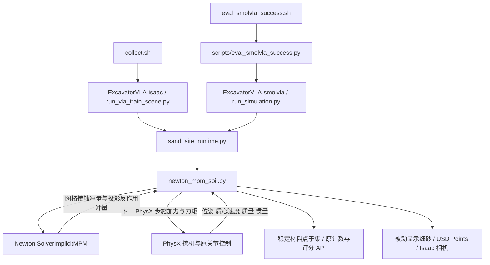

# ExcavatorVLA 土壤仿真技术说明

版本日期：2026-11-04。适用对象：接手仿真开发、数据采集与策略评估的工程人员。

当前方案已经接入原挖掘机场景：Isaac Sim 负责场景、渲染和运行循环，PhysX 继续计算挖机刚体与关节，Newton 的隐式 MPM 求解器计算土壤。适配器把真实铲斗运动传给土壤，并把土壤反作用力传回 PhysX。正常启动服务器外层 `collect.sh` 和 `eval_smolvla_success.sh`，默认使用这套土壤。

目前版本侧重可运行的采集与交互流程：最多 40000 个物理材料点、默认 10 cm 网格、14 mm 显示颗粒。土壤属于无黏聚的干燥摩擦颗粒近似，尚未做真实土样标定。跟随视频提示抬升与转向时的铲斗姿态是大量失土的重要排查方向；控制角度尚未修改，也尚未完成保土角度的对照试验。

## 1 系统组成与入口



图中两个子仓库各自有一份 `sand_site_runtime.py` 和一份相同的土壤适配器，进程只加载自己所属仓库的文件。只更新其中一份会造成采集与评估物理不一致。

服务器工作目录为 `/root/gpufree-data/ExcavatorVLA_new`。本地主要源码目录为 `D:/temp/ExcavatorVLA/ExcavatorVLA-isaac-git`。本地评估仓库的本轮适配器同步副本位于 `tmp/newton_integration/work/ExcavatorVLA-smolvla/`，它是同步暂存目录，不应误认成已配置好的本地仿真环境。

已验证的服务器环境记录为 Isaac Sim 6.1 RC、Newton 1.5.0、Warp 1.16.0。适配器启用 `omni.warp.core` 和 `isaacsim.pip.newton`，直接使用安装包内的 Newton 求解器。Isaac 的原生实验性 Newton 刚体后端没有被启用；整机仍由 PhysX 计算。当前方案不要求安装另一套仿真软件。

## 2 三种点的区别

理解以下三个集合，才能正确调整性能、外观与计数：

| 集合 | 作用 | 本轮典型数量 | 是否参与物理 |
| --- | --- | ---: | --- |
| MPM 材料点 | 承载位置、速度、质量、形变等物理状态 | 38031 | 是 |
| 评分代表点 | 真实材料点 ID 的固定子集，供原采集和评分读取 | 26457 | 继承对应材料点的运动，不另做求解 |
| 显示细砂 | 随材料运动的被动显示样本 | 152124 | 否 |

材料点是土壤体积的数值采样，不等于一颗真实沙粒。屏幕上看到的球形细砂也不是逐颗做球球碰撞的离散元模型。当前大部分土壤力学计算在 MPM 网格上完成，再更新材料点。

因此把显示颗粒从 12 mm 改成 14 mm，会让画面更饱满，但不会改变土壤质量、碰撞尺寸、材料摩擦或评分计数。反过来，增加显示点不能补偿粗网格的物理精度。

## 3 土壤生成和质量保持

### 3.1 完整源采样

`material_layout()` 从原场景读取土堆 XY 覆盖范围、可挖区域掩码、地面高度和初始高度函数。它先在 XY 平面分格，再按每列高度生成 Z 方向层数。

`choose_resolution()` 在分配大量数组前计算点数。默认采样间距为 0.075 m、网格边长为 0.10 m。若完整土源超过 40000 点，就按同一比例增大间距和网格，重新计数，直到满足预算。算法保留源的整体覆盖范围，不通过截断数组删掉某一侧土堆。

`sample_material()` 在每个采样单元内加入确定性的随机抖动，默认种子为 4107。XY 实际单元尺寸由源边界均分得到，因此每点初始体积为 `V_p = dx * dy * spacing_z`，不一定恰好等于请求间距的立方。

### 3.2 总质量与代表点

默认保留原场景总质量：

```text
M_total = N_legacy * PARTICLE_MASS_legacy
rho     = M_total / (N_material * V_p)
m_p     = rho * V_p
```

最近一轮源包含 26457 个原计数点，原质量为 0.36 kg/点，总质量约 9524.52 kg。分配到 38031 个 MPM 材料点后，每点约 0.25044 kg。这里的密度由总质量与采样体积反推，是兼容原载荷尺度的设置，不是通过土样实验测得的材料密度。

代表点数量为 `min(N_material, N_legacy)`，使用固定种子 4108，从材料点中无放回均匀选择稳定 ID。每个代表点对应的质量为：

```text
m_metric = m_p * N_material / N_metric
```

标准场景仍能维持约 2.64 万个计数点及原质量尺度。如果主动把预算降得很低，使材料点少于原计数点，基于点数的旧阈值就需要重新核对；质量换算不能自动保证点数阈值等价。

## 4 MPM 材料和求解配置

MPM 可理解为在“随土移动的材料点”和“用于计算的网格”之间传递物理量。求解器将材料信息映射到网格，处理材料响应、重力和碰撞约束，再更新材料点状态。项目负责模型构建、碰撞接入和步进，具体离散化与隐式求解由安装版本的 `SolverImplicitMPM` 实现。

| 参数 | 当前默认值 | 解释 |
| --- | ---: | --- |
| 重力 | `(0, 0, -9.81)` m/s² | Z 轴向上 |
| 材料摩擦系数 | 0.68 | 控制干颗粒材料的摩擦响应 |
| Young 模量 | `1e15` Pa | 沿用测试的高刚度、塑性主导配置 |
| 压缩屈服压力 | `1e12` Pa | Newton 的 `yield_pressure` 参数 |
| 黏聚屈服应力 | 0 | `yield_stress` |
| 抗拉比例 | 0 | `tensile_yield_ratio` |
| 剪胀参数 | 0 | `dilatancy` |
| 黏度 | 0 | `viscosity` |
| 求解网格 | 0.10 m 起 | 点预算不足时随间距一起增大 |
| 最大迭代数 | 150 | 隐式求解配置 |
| 容差 | `1e-4` | 隐式求解配置 |
| 土壤与碰撞体摩擦 | 0.5 | 与材料内部摩擦是不同参数 |
| 碰撞黏附 | 0 | 无额外黏附 |

这些参数构成可运行的干燥摩擦颗粒基线，不应直接称为已标定的某一种真实土壤，也不是湿土、黏土或含水流体模型。早期旧 PhysX 非流体粒子方案中的流体黏度、黏聚参数讨论，不能直接代替对 Newton 材料参数的判断。

当前 10 cm 网格是为原场景体量与性能预算作出的取舍。早期独立小土堆测试曾使用 2.5 cm 网格，该结果不能当成当前完整场景仍有同样分辨率的证据。

## 5 碰撞几何接入

`_import_colliders()` 遍历 USD 场景中的启用碰撞体，并包含实例代理中的几何。支持三角网格、Cube 和水平 Plane；遇到当前不支持的有效碰撞几何会报错，不悄悄替换成另一种形状。

对三角网格，适配器将多边形扇形三角化，处理面朝向及负缩放，并把缩放烘焙进顶点。运动碰撞网格转换到所属刚体的局部坐标，随后使用真实刚体位姿更新；这样可保留铲斗凹面与开口。地面、停车地板和车厢静态网格分别保留，避免把不同表面拼成一个网格后干扰有符号距离查询。

原矩形土壤挡墙被隐藏并关闭碰撞，土堆不再靠它们围住。若场景显式启用受支持的圆形挡墙，代码仍允许导入。

最近实际导入列表中，运动体为 `bucket_link`；它的 `visuals` 和 `collisions` 下均有启用碰撞的网格，因此两者都会被导入。当前实现遵循 USD 上的碰撞启用状态，没有根据路径名字自行去重。这一点应作为后续资产审计项，不能简单把所有 `visuals` 路径认定为无碰撞。

动态碰撞外扩边距为 `min(0.0125, 0.5 * voxel_size)` m，在当前网格下为 1.25 cm。每个 MPM 子步还调用 `project_outside()` 做穿入修正，其最近点查询距离为 `max(0.25, sqrt(3) * voxel_size)` m。查询距离是查找表面的范围，并不代表把铲斗增厚 25 cm。

## 6 PhysX 与 Newton 的双向受力

### 6.1 刚体状态映射

`_attach_view()` 创建 Warp 后端的 PhysX rigid body view，并显式建立 PhysX 顺序与 Newton 顺序的映射。传入 Newton 的数据包括世界位姿、质心处线速度、角速度、局部质心、质量和惯量。

四元数按 `(x, y, z, w)` 处理。刚体代理保留有限质量与惯量，不作为无限质量的移动障碍物使用；否则土壤可能对实际较轻刚体产生不合理的冲量反馈。运动网格的参考点是 link 原点，而速度和惯量计算需要考虑质心偏移。

### 6.2 每个物理步的执行顺序

在常见的 60 Hz PhysX 步长下，MPM 每帧固定做两个子步。实现公式为 `max(1, ceil(dt * 120 - 1e-6))`，其中微小修正避免 float32 的 1/60 被误判成三个子步。高速离群点不会触发全局自适应加子步。

1. **PhysX 步前**：`_on_pre_step()` 将上一帧完成的土壤接触结果作为世界坐标的力和力矩，施加到真实刚体。
2. **PhysX 步进**：原控制器、驱动、关节约束与刚体积分正常执行。
3. **PhysX 步后**：`advance()` 读取实际位姿和速度，减去上一帧土壤冲量对应的自由刚体速度增量，估计本轮土壤求解使用的自由速度。
4. **MPM 子步**：传入刚体代理状态，进行材料求解、防穿透投影、材料显示形变更新，并归约接触冲量。将本子步冲量用于预测有限质量代理下一子步的速度。
5. **帧末**：累加本帧子步冲量，除以 PhysX 帧长得到下一帧待施加的力和力矩。更新材料点位置、原计数接口与显示状态。

这是一物理帧延迟的分区耦合。MPM 两个子步中使用本次读到的刚体位姿，并更新代理速度；它并不在子步内重新求解整台挖机的关节动力学。自由刚体逆质量、逆惯量近似也不能完全代表受约束关节系统的有效惯量。

### 6.3 网格接触冲量与力矩

Newton 的 `collect_collider_impulses()` 返回刚体侧冲量 `J_i`、作用位置 `x_i` 与碰撞体 ID。碰撞体 ID 再映射到刚体 ID；静态碰撞体不进入运动刚体的反馈数组。

对 link 原点 `o_b`，GPU 归约：

```text
J_b = sum_i J_i
L_b = sum_i cross(x_i - o_b, J_i)
F_b = sum_substeps(J_b) / dt
T_b = sum_substeps(L_b) / dt
```

应用时将 `F_b` 作用在 `o_b`，同时施加 `T_b`，两者参考点一致。预测刚体角速度时，再把绕原点的角冲量换算到质心，并用世界坐标下的逆惯量计算增量。

### 6.4 已修复的投影反作用力遗漏

Newton 的防穿透投影会额外改变材料点速度，但这部分变化不包含在网格冲量返回值中。旧适配器只归约网格冲量，因此漏掉了相应刚体反作用力。

当前在 GPU 保存投影前的位置和速度，调用同样的碰撞查询识别受影响刚体，并额外累加：

```text
J_projection,p = -m_p * (v_after_projection - v_before_projection)
L_projection,p = cross(x_before_projection - o_b, J_projection,p)
```

这部分与网格冲量合并后统一反馈，避免漏传或重复施加。新增位置、速度缓冲留在 GPU，CPU 回读规模仍为每刚体每子步 6 个分量。

修复补全了速度修正对应的反作用冲量；位置投影本身的数值位移、一帧延迟和关节有效惯量近似仍存在，因此不宣称整个算法严格守恒。实现调用已安装 Newton 的内部 `collision_sdf` 接口，升级库版本后需要重新验证接口及符号约定。

## 7 显示与数据接口

### 7.1 USD 显示

适配器使用 `sample_render_grains()` 生成被动细砂，每材料点显示样本数为：

```text
grains_per_point = max(1, min(8, 160000 // N_material))
```

在当前最多 40000 点的预算内，显示总数不超过 160000。每个子步通过 Newton 的材料帧更新和细砂更新函数推进显示样本。`_on_update()` 把细砂位置写入 `/World/SandSite/ParticleSystem/FineGrains` 的 `UsdGeom.Points`，直径默认 `0.014` m。

原代表点的 Points 对象继续提供位置和原接口所需属性，但设置为不可见。显示细砂放在单独的兄弟 Xform 下，避免将显示对象放在另一个 Points Gprim 的子树中导致渲染裁剪问题。

### 7.2 采集与评估

`sand_site_runtime.py` 中的后端分支在生成土壤时调用 `_mpm.create()`，并通过 `_mpm.augment_api()` 暴露后端标识、粒子位置、质量和诊断接口。原控制器和评分仍读取原 API，数据导出格式不依赖显示细砂数量。

历史采集导出检查中，状态、effort、动作分别为 28、4、4 维，三路图像为 10 Hz。改变 MPM 物理后，已有策略的成功率仍需重新评估；接口和文件格式兼容不代表数据分布或任务成功率保持不变。

原评分中的 `spill` 为：

```text
spill = max(0, lift_count - final_bucket_count - bin_gain)
```

它包含抬升后未保留在斗内、也未计入料箱的材料，不能单独区分途中洒落、卸到箱外、区域计数误差或穿透。诊断必须结合物理材料轨迹与视频，而不能把 `spill` 直接当成穿壁计数。

## 8 运行状态与性能优化

接触网格的大数组留在 GPU，通过 Warp 原子归约只回读净冲量与净角冲量。每个子步 CPU 接收 `6 * body_count` 个 float32。材料最大速度也由 GPU 求最大值，每 15 个物理步仅回读一个标量。材料位置和显示位置仍会为了评分与 USD 更新回读；当前方案不是完全没有 GPU 与 CPU 传输。

土壤休眠要求连续三次检查满足最大材料点速度低于 0.01 m/s，并且运动刚体的保守扫掠包围盒远离土壤。携土铲斗或正在接近的刚体会阻止休眠或触发唤醒。设置休眠阈值为 0 可以禁用此优化。

异常处理包括非有限状态/冲量检测，以及材料最低高度低于地面三个网格时的逃逸检测。错误会记录 `real_sand_error` 并暂停时间线，不继续把静止或失效土壤当成正常采集。地面阈值是保护条件，不是接触精度容许值。

标准评估默认每轮启动新模拟器。诊断用的进程复用模式会缓存已沉降的材料物理状态及显示细砂；源规格不变时平移恢复材料、重建碰撞模型、清除求解器 warm start，并短暂步进。源形状或土量改变时回退到完整重建。重置会释放旧订阅，避免一帧被重复求解。

## 9 参数与启动方式

以下参数在创建土壤时读取；修改进程环境后需要重新创建土壤或重启运行才能生效。

| 环境变量 | 默认值 | 作用 |
| --- | --- | --- |
| `EXCAVATOR_SOIL_BACKEND` | `newton_mpm` | 可显式设为 `physx` 使用保留的旧分支 |
| `EXCAVATOR_MPM_MAX_PARTICLES` | `40000` | 可调低，拒绝大于 40000 |
| `EXCAVATOR_MPM_VOXEL_SIZE` | `0.10` | 请求的最小网格边长，单位 m |
| `EXCAVATOR_MPM_PARTICLE_SPACING` | 网格的 0.75 倍 | 请求的采样间距，不能大于网格 |
| `EXCAVATOR_MPM_RENDER_DIAMETER` | `0.014` | 显示直径，单位 m |
| `EXCAVATOR_MPM_DENSITY` | 保持原总质量 | 显式密度覆盖质量兼容策略 |
| `EXCAVATOR_MPM_DEVICE` | PhysX CUDA device | CUDA 可见设备编号 |
| `EXCAVATOR_MPM_SEED` | `4107` | 材料初始采样种子 |
| `EXCAVATOR_MPM_SLEEP_SPEED` | `0.01` | 休眠速度阈值，单位 m/s；0 禁用 |

服务器使用原启动包装器，以避免加载错误的 Python 或动态库：

```bash
cd /root/gpufree-data/ExcavatorVLA_new
export POLICY_PYTHON=/root/gpufree-data/conda/envs/ExcavatorVLA-current/bin/python
export OMNI_KIT_ALLOW_ROOT=1

# 采集 1 条成功数据，1 个 worker，GPU 0
bash collect.sh 1 1 0

# 使用实际 checkpoint 替换示例路径
bash eval_smolvla_success.sh /absolute/path/to/pretrained_model 1 350 100
```

当前评估脚本也提供 `--soil-backend newton_mpm` 或 `--soil-backend physx` 显式选择。旧土壤临时对照可用 `EXCAVATOR_SOIL_BACKEND=physx bash collect.sh 1 1 0`。切换后端后启动的新进程生效，已运行的进程不会自动替换模型。

启动后核对 `[MPM READY]` 的点数、网格、间距、质量、碰撞体与设备；运行中观察 `[MPM STEP]` 的仿真时间、最低/最高高度、峰值反力和单步耗时。详细字段见 `diagnostics()`，包括 `solver_substeps`、`host_contact_values`、`render_grain_diameter_m` 和 `last_link_wrenches`。

## 10 验证结果与适用范围

### 10.1 正确性和流程检查

| 检查 | 结果 | 能支持的结论 |
| --- | --- | --- |
| 7 项 CPU 测试 | 通过 | 采样预算、质量换算、三角化、固定步长和力矩归约参考正确 |
| GPU 网格冲量参考 | 通过 | GPU 归约与 CPU 独立参考相符 |
| GPU 投影冲量参考 | 通过 | 新增 `-m*delta_v` 与偏心力矩计算符合独立参考 |
| 3 kg 偏心刚体落土 | 240 步通过，最终速度约 0.0206 m/s | 双向力会作用到真实 PhysX 刚体，限定场景下稳定 |
| 暂停、重置、休眠唤醒 | 通过 | 回调生命周期与状态恢复基本可用 |
| 20 m/s 单点防穿地 | 通过，5 个物理步仍为 10 个 MPM 子步 | 该测试条件下防穿透有效 |
| 优化版原 collect.sh | 退出 0，导出 282 帧与三路视频 | 当时的外层采集导出流程可用 |
| 优化版原评估入口 | 两轮各 8 动作完成，无接口错误 | 当时的短评估与进程复用可用，不能作为任务成功率 |
| 最新反作用力修复后完整试挖 | 执行完成，无物理致命错误 | 原场景挖掘与卸料流程继续运行 |

最新反作用力修复后没有重新跑完整外层数据导出和 350 步策略成功率评估。历史流程通过与最新小场景/完整试挖通过分别记录，不能合并表述为已经重新验证全部流程。

### 10.2 性能量级

| 版本和场景 | 仿真条目时长 | 实际条目耗时 |
| --- | ---: | ---: |
| 历史密采样，约 340 万材料点 | 17.75 s | 2454.72 s，约 41 分钟 |
| 优化后完整采集条目 | 28.20 s | 225.15 s |
| 最新投影反力修复后试挖 | 18.20 s | 183.01 s |
| 最新跟随双相机试挖 | 18.20 s | 195.22 s |

这些是不同运行的端到端条目计时，不包括全部启动开销，也不是相同物理分辨率下的严格基准。当前约四万点显著减轻了负担，但仍慢于实时。视频按仿真时间播放，20 秒视频不代表服务器只算了 20 秒。

### 10.3 失土与接触诊断

14 mm 显示下的对照中，修复前抬升 529 个评分点、进箱 14，修复后抬升 519、进箱 18。缺失投影冲量的逐帧模长之和约为网格冲量对应值的 1.05%，峰值缺失反力约 611 N。修复真实存在的反馈遗漏后，大量未进箱现象仍然存在。

两轮各 1329 步的材料点相对斗壁线段相交诊断均未检测到穿壁。该检查受时间采样、旋转线性近似和网格几何质量限制，不能外推为所有条件下都不会穿透。

固定卸料视角和随后跟随铲斗的侧视/俯视显示：到达车厢前已出现失土，抬升与转向时的斗口姿态值得优先检查。最终斗口能到达车厢上方；日志中约 1.7 m 的预测落点偏差不能单独证明主要损失来自卸偏。当前判断是动作姿态存在较强嫌疑，而非已通过对照排除所有物理误差。

下一步验证应保持土壤配置不变，只比较原动作与“抬升/转向时维持合适斗口朝向”的动作，记录到达车厢前载土量、进箱量、实际姿态和洒落时间。这项控制修改尚未实施。

## 11 代码位置与修改建议

| 功能 | 主要位置 |
| --- | --- |
| 后端选择 | `newton_mpm_soil.py` 的 `enabled()` |
| 土源采样与点数预算 | `material_layout()`、`choose_resolution()`、`sample_material()` |
| 总质量和代表点 | `material_density()`、`NewtonSoil.__init__()`、`metric_positions` |
| 材料参数、默认显示尺寸 | `NewtonSoil.__init__()` |
| 网格冲量 GPU 归约 | `make_gpu_kernels()` 中 `contact_wrench` |
| 投影反作用力修复 | `make_projection_wrench_kernel()` 与 `advance()` |
| 碰撞体导入及参数 | `_import_colliders()`、`_setup_colliders()` |
| PhysX 刚体状态映射 | `_attach_view()` |
| 双向步进 | `_on_pre_step()`、`advance()` |
| 显示更新 | `_on_update()` |
| 状态缓存和重置 | `cache_initial_state()`、`restore_initial_state()` |
| 旧土壤分支与 API 接入 | 两个子仓库的 `sand_site_runtime.py` |
| 评分中的失土定义 | `excavator_runtime.py` 的 `multi_scoop_cycle_report()` 等计数函数 |

核心源码：[newton_mpm_soil.py](../scripts/excavator_app/newton_mpm_soil.py)。集成钩子：[sand_site_runtime.py](../scripts/excavator_app/sand_site_runtime.py)。

只改善外观时优先调显示直径；需要改变堆形或流动行为时应研究材料模型与参数；需要检查小尺度接触时应研究网格分辨率和实际网格几何；需要保持抬升载土时应首先验证控制姿态。这样能避免用显示变密、额外黏附或放宽评分掩盖另一层的问题。

## 12 可视化复现与结果文件

额外观察相机采用独立实验入口，不改变生产采集相机：

| 脚本 | 用途 |
| --- | --- |
| `record_nearview.py` | 固定土堆近景 |
| `record_unload.py` | 固定车厢侧上方与俯视 |
| `record_bucket_follow.py` | 跟随实际铲斗中心的侧视与俯视，随转向移动、保持水平 |
| `audit_contact.py` | 额外记录投影冲量和斗壁穿越诊断，开销高于正常运行 |

例如在服务器生成一次新的跟随视角录制：

```bash
cd /root/gpufree-data/ExcavatorVLA_new
export OMNI_KIT_ALLOW_ROOT=1
export EXCAVATOR_ISAAC_DIR=/root/gpufree-data/isaacsim
export EXCAVATOR_NEARVIEW_OUTPUT="$PWD/ExcavatorVLA-isaac/backups/follow_$(date +%Y%m%d_%H%M%S)"
export EXCAVATOR_AUTO_SCENE_SEED_NAMESPACE=soil-visualization
cd ExcavatorVLA-isaac
../run_isaac_python.sh experiments/isaac_mpm_soil/record_bucket_follow.py \
  --headless --auto-collect --no-bridge --active-gpu 0 --physics-gpu 0 \
  --success-count 1 --max-attempts 1 --sand-amount 1 \
  --dataset-root "$EXCAVATOR_NEARVIEW_OUTPUT/raw" --disable-export
```

该入口生成双视角 PNG、帧时间表和独立原始条目；MP4/GIF 需要后续编码。最近跟随录制为 201 帧、10 Hz、20.1 秒，覆盖仿真时间约 2.07–22.07 秒。视频文件保存在本地工作区：

- [同步跟随视角](../../output/soil_visual_results/bucket_follow/bucket_follow_two_views.mp4)
- [侧面跟随视角](../../output/soil_visual_results/bucket_follow/bucket_follow_side.mp4)
- [上方跟随视角](../../output/soil_visual_results/bucket_follow/bucket_follow_overhead.mp4)
- [固定卸料双视角](../../output/soil_visual_results/unload_views/unload_two_views.mp4)

以上相对链接依赖本地工作区的 `output` 目录；仅复制源码仓库到服务器后，这些视频链接不随之迁移。

## 13 备份和恢复

原始备份位于服务器：

```text
/root/gpufree-data/ExcavatorVLA_new/ExcavatorVLA-isaac/backups/soil_mpm_20261025_172114/
```

| 备份文件 | 内容 |
| --- | --- |
| `code_before.tar.gz` | 原始 177 份源码与入口文件 |
| `manifest.json` | 原始逐文件校验值 |
| `deployed_manifest.json` | 集成部署文件的当前登记校验值 |
| `optimization_20261025_022608/dense_candidate_before.tar.gz` | 性能优化前密采样版本 |
| `contact_audit_20261103_184614/code_before.tar.gz` | 本轮改动前 12 mm 适配器 |
| `contact_audit_20261103_184614/before_projection_fix.tar.gz` | 14 mm 显示、投影反作用力修复前版本 |

目录时间戳按生成脚本使用的时区记录；本轮 `20261103_18...` 对应北京时间 2026-11-04。

临时切旧土壤优先使用后端参数。完整源码恢复工具为 [restore_soil_integration.py](../experiments/isaac_mpm_soil/restore_soil_integration.py)，它先核对校验值，遇到后续未知修改会拒绝覆盖。其恢复范围是三份原集成源码，并移除两份适配器；不会把整个父目录解压覆盖。执行恢复前需停止相应采集和评估，确认要保留的后续工作已经另存。

## 14 当前限制与后续工作

当前最需要验证的是抬升和转向过程中的保土姿态。跟随视角为判断提供了直接证据，但应通过只改变控制角度的对照来建立因果关系。

物理方面仍有 10 cm 网格的分辨率限制、一帧延迟耦合、自由刚体惯量近似、投影位移的数值误差、碰撞资产质量及材料未标定等限制。原来停放间隙约 0.45 m 的设置也属于整机姿态与地面关系问题，不是本次土壤适配器所解决的内容。

后续改动应保留当前回归基线，分别验证材料堆形、铲斗保土、载荷响应和策略表现。原质量门槛标记 `trainable` 仅说明通过现有规则，当前仍可能伴随约 97% 的失土警告；不能把“流程跑完”当成“挖掘效果已达到要求”。

历史集成记录见 [NEWTON_MPM_INTEGRATION.md](NEWTON_MPM_INTEGRATION.md)，优化与接触排查记录见 [NEWTON_MPM_OPTIMIZATION.md](NEWTON_MPM_OPTIMIZATION.md)。本说明以当前配置为主，历史性能和测试结果均保留其适用版本。
